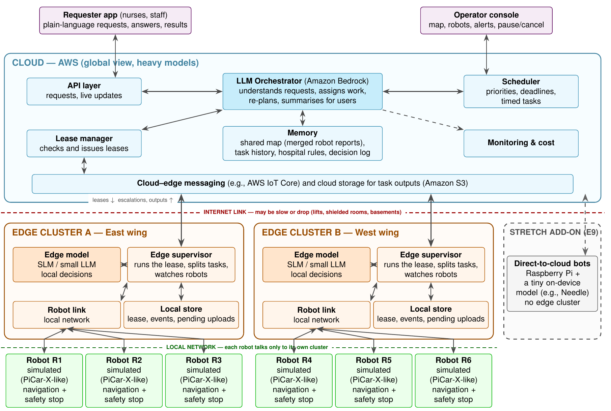
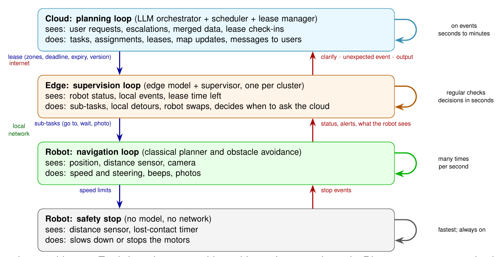
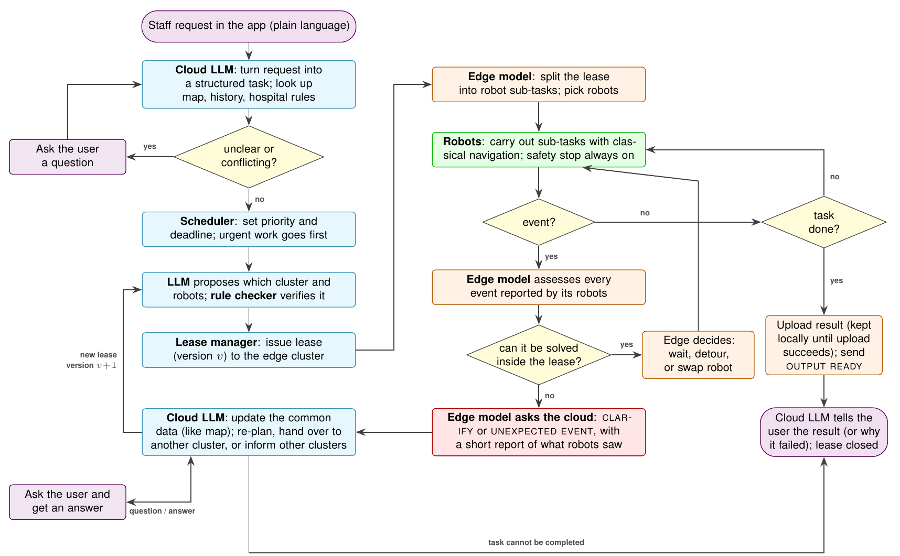
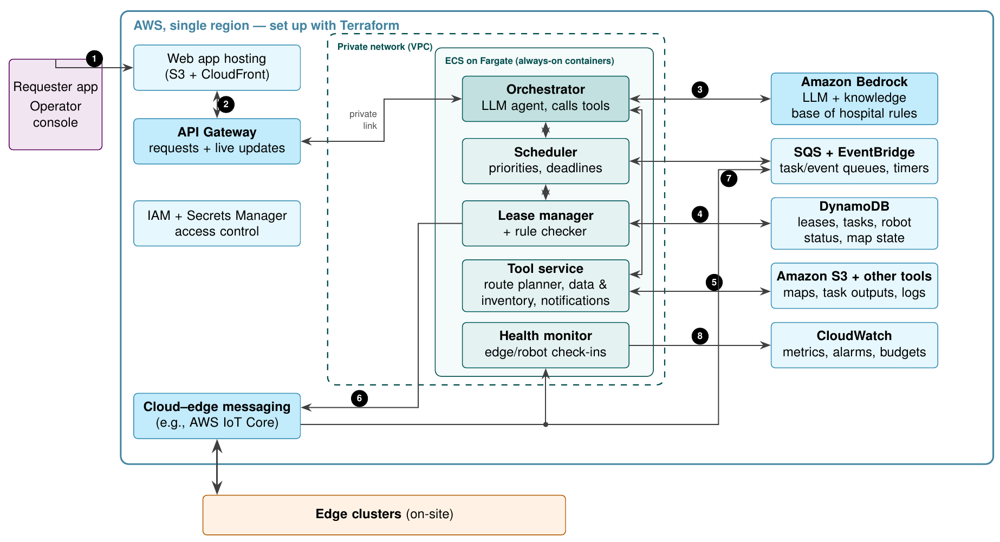

# Nimbus

**Robots that understand plain-language requests, share one picture of a building, and keep working when the
network drops.**

Nimbus runs a fleet of delivery robots spread over several areas of a site, for example the wings of a hospital.
A person types an ordinary request ("Need an infusion pump at 2B-12, urgent"). A language model in the cloud
works out what is meant, asks a question if the request is unclear, and checks every plan against hard rules.
It then hands the job to the site computer that runs that area's robots. That site computer is called the
*edge*. The cloud hands over a time-limited permission called a **lease**. Inside the lease, the edge and its
robots act on their own, even if the internet connection is gone for minutes. They contact the cloud again only
when they need help or have a result.

This repository contains the whole system: the cloud service, the edge software, a simulated hospital with six
robots, the web apps, the AWS deployment, and the experiments that measure all of it against the plan.

Baseline Version can be found under :
**Baseline Tag:**  rt-baseline 
**Commit Hash:** f03afd7

**Demo:** a request typed in the app, answered by the cloud, and carried out by the simulated robots
([docs/media/demo.mp4](docs/media/demo.mp4)).

<video src="docs/media/demo.mp4" controls width="100%"></video>

- Plan and requirements: [PRD.md](PRD.md)
- How the code is organised (for developers): [dev.md](dev.md)
- Message formats between cloud and edge: [docs/EDGE_CLOUD_PROTOCOL.md](docs/EDGE_CLOUD_PROTOCOL.md)
- Measured results: [results/final/RESULTS.md](results/final/RESULTS.md) (one table for every final experiment)
- Install, run and reproduce everything: [section 6](#6-install-run-and-reproduce)

---

## 1. The problem

Many organisations now have robots that move things around: hospitals, warehouses, airports, factories, university
campuses. When those robots must work for people across a large site, four difficulties appear together.

1. **People ask in their own words, and leave things out.** A nurse writes "a pump to 2B", not a form with item code,
   pickup point, destination and deadline. Someone, or something, has to understand the request, notice what is
   missing and ask.
2. **The site keeps changing, and everyone needs the same picture of it.** Corridors get blocked, doors are locked, a
   ward is declared infectious, a robot breaks down. What one robot sees in the east wing can change what a robot in
   the west wing should do. That calls for one shared, central view.
3. **The network is not reliable.** Wi-Fi and mobile coverage drop in lifts, stairwells, shielded rooms and
   basements, often for minutes. A robot that must ask a distant server before every move stops dead in exactly
   those places.
4. **Mistakes are not acceptable.** A robot must never enter an isolation ward with routine equipment, take the last
   paediatric pump to the wrong ward, or keep driving on orders that have been withdrawn.

Today's hospital delivery robots (for example Aethon TUG) mostly follow fixed routes with a fixed menu of jobs. They do
not understand free-form requests, combine what several robots see, or re-assign work when plans change.

### Why not just one computer?

| Option | Why it is not enough on its own |
| --- | --- |
| Everything in the cloud | One shared view, and a large model that understands language well. But every robot decision then needs the internet, so robots freeze in every dead zone (we measure this: configuration C2 below). |
| Everything on site | Works offline. But a model that understands open-ended requests is too large to run on a small site computer, and each wing would have its own partial view of the building. |
| Nimbus: split by tier | **Cloud:** understanding, global planning and shared memory. **Edge:** a small local model with bounded authority that keeps working through outages. **Robot:** navigation and a safety stop that need no network at all. |

### The key idea: leases

A **lease** is the cloud's written permission for one job. It lists the robots, the zones they may and may not
enter, a speed limit, a deadline, an expiry time and a version number. While a lease is valid, the edge decides
locally. Small problems are handled inside the lease: a person in the way means wait, a blocked corridor means take
another permitted route, a broken robot means swap in another robot. When the lease expires, or the cloud issues a
newer version, the old permission is gone, so robots never act on stale orders. The idea comes from classic
distributed-systems leases (Gray and Cheriton, 1989), applied here to robots.

The edge contacts the cloud in only three situations:

| Message | Sent when | Example |
| --- | --- | --- |
| `CLARIFY` | The instruction or situation is too ambiguous for the edge | "Robot sees an unknown object in the corridor: wait, or treat the route as closed?" |
| `UNEXPECTED_EVENT` | The plan no longer works and nothing inside the lease fixes it | "The door at the west south hall is locked" |
| `OUTPUT_READY` | A job produced a result | Delivery photo stored; equipment count done |

### Beyond hospitals

The hospital is our test case. The same structure fits any site with several areas, a shared map and an unreliable
link:

- **Warehouses and factories:** one edge per building or floor, with a central planner for orders.
- **University or airport campuses:** robots in different buildings, sharing what each has seen.
- **Disaster response:** robots exploring a partly collapsed building over a patchy radio link.
- **Mines and remote sites:** coverage can be absent for long periods, so bounded local authority is the only option.

The domain is not hard-coded. Places, items, priorities and rules live in a **domain pack** (a folder of JSON files,
see `packs/`), so the same code runs a hospital pack, a rescue pack or a 10-robot scale pack.

---

## 2. Words used in this project

| Term | Meaning |
| --- | --- |
| **Cloud** | The central service, running on Amazon Web Services (AWS). It talks to people, plans, keeps the shared map and memory, and issues leases. |
| **Edge** / **edge cluster** | A computer on site that runs the robots of one area (here: one hospital wing). Our setup has two: `east-wing` and `west-wing`, with three robots each. |
| **Robot** | A small wheeled robot (simulated here, modelled on the PiCar-X / MIT RACECAR) that follows simple commands: go to, wait, stop, photo, beep, report. |
| **LLM** | Large language model: a model that reads and writes text. The cloud uses **Amazon Nova Lite** through **Amazon Bedrock**, AWS's hosted model service. |
| **SLM** | Small language model (1 to 3 billion parameters) that runs on the edge computer, for example Qwen2.5-1.5B served by Ollama or llama.cpp. It makes local decisions within the lease. |
| **Lease** | Time-limited, versioned permission for one job (see above). |
| **Escalation** | A message from the edge asking the cloud for help or reporting a result (`CLARIFY`, `UNEXPECTED_EVENT`, `OUTPUT_READY`). |
| **Rule Checker** | Deterministic code in the cloud that verifies every plan the model proposes: right cluster, free and working robot, stock available, no forbidden zone, a real route. No lease is issued without it. |
| **Fallback** | When the cloud model is unavailable, plain rules take over (nearest free robot, fixed priority order), and users are told the system is in reduced-autonomy mode. |
| **Domain pack** | The JSON description of a site: map, places, items, priorities, rules and prompts. |
| **C1, C2, C3** | The three configurations we compare. **C1** is Nimbus (cloud LLM, leases, edge SLM). **C2** is cloud-only: the edge relays every decision to the cloud model. **C3** uses no model at all (forms and fixed rules). |
| **Gazebo** | A robot simulator. Our hospital world and six robots run in Gazebo Fortress; a lighter "kinematic" simulator runs the same map without it. |
| **Decision log** | An append-only record of every decision: who decided (cloud, edge, rule), on what input, with what output, under which lease version. |

---

## 3. How a request flows

This example is scenario SC-1 from the plan: "Need an infusion pump at 2B-12, urgent."

1. **Request.** A nurse types the request into the requester app (a web page served by the cloud).
2. **Understand.** The cloud model turns the text into a task (item, destination, priority, deadline). Code then
   checks the result against the words actually used. A place nobody named is asked for, not guessed.
3. **Ask if needed.** 2B is a paediatric ward, and a hospital rule (SOP-PAED-01) says a standard pump there needs
   confirmation. The cloud asks "Do you need a paediatric pump?", and the nurse answers in the app.
4. **Plan and check.** The code ranks which robots could do the job. If two wings could, the model picks one. The
   Rule Checker verifies the choice. After two rejected proposals, plain rules decide.
5. **Lease.** The cloud issues lease version 1 to the east-wing edge: robot, route, permitted zones, 12-minute
   deadline, expiry.
6. **Local execution.** The edge splits the lease into robot commands. If something gets in the way, the edge's small
   model decides within the lease: wait, detour or swap robots.
7. **Help only when needed.** If the only corridor is locked, the edge sends `UNEXPECTED_EVENT`. The cloud updates the
   shared map, re-plans (lease version 2) or hands the job to another wing, and warns other affected wings.
8. **Result.** The robot takes a delivery photo, and the edge sends `OUTPUT_READY`. Results are kept on the edge's
   disk until the upload succeeds. The cloud tells the nurse, updates its memory ("2B usually wants the paediatric
   pump") and closes the lease.

If the internet drops at step 6, the robot keeps going under its lease. Messages wait on the edge's disk and are
sent on reconnection. If the lease expires first, the robot parks somewhere safe, never in a doorway or lift.

---

## 4. Architecture

These are the architecture figures from the project plan ([PRD.md](PRD.md)), unchanged.

**Figure 1: components and tier boundaries (cloud, edge clusters, robots).**



Data crossing the cloud-edge boundary is limited to leases, escalations and check-ins, typically under 2 KB each.
Results such as photos cross only inside `OUTPUT_READY` messages, never as a raw camera stream.

**Figure 2: nested control loops.** Each loop keeps working without the one above it.



**Figure 3: life of a task.** Every event goes to the edge model first, which handles it inside the lease or asks the
cloud.



**Figure 4: AWS deployment** (Terraform in `infra/terraform/`).



---

## 5. What each part does

### Cloud (`server.py`, `cloud/`, `packs/`)
- **Understands requests** with Amazon Bedrock (Nova Lite) using forced tool calls. Every model answer is checked
  against the requester's own words before it is used.
- **Asks clarifying questions** when details are missing or a rule requires confirmation, and resumes from the answer.
- **Remembers habits** ("2B has confirmed the paediatric pump twice"), so repeat requests are not asked again.
- **Applies plain-language rules** such as "Ward 2C is now isolation; hold routine deliveries, urgent ones can still go
  in", including moving equipment out.
- **Schedules by priority and deadline:** urgent first, earliest deadline first within a class.
- **Proposes and checks allocations:** the model chooses only among candidates the code has ranked, and the Rule
  Checker verifies every choice. Two failed proposals mean plain rules take over.
- **Issues versioned leases**, renews them on check-in and fences outdated versions (an old version gets HTTP 409).
- **Reacts to edge reports:** keeps a shared map of closures, re-plans around blocked zones, gives a failed robot's
  job to another robot, hands work over to another wing, warns only the wings that are affected, and alerts the
  operator when nothing works.
- **Survives model outages** through a circuit breaker and deterministic fallback, and tells users.
- **Records everything:** an append-only decision log, a per-task trace of every model call (prompt, tools, tokens,
  latency), and cost counters for every term of the plan's cost formula.

### Edge (`edge/`)
- **Edge supervisor:** one per wing. It receives leases, splits them into robot commands, watches the robots, and
  enforces the lease (geofence, expiry, version).
- **Edge model:** a small local model (Ollama or llama.cpp) chooses between wait, local detour, robot swap, safe park
  and ask the cloud. A rule engine takes over if the model is slow, unavailable or answers outside the allowed actions.
- **Store-and-forward:** escalations and results are kept in a local SQLite database until the cloud has them.
- **Reconnection summary**, safe parking on expiry, and **takeover** by a standby edge node if one fails.

### Robots and simulation (`simulation/`)
- **Hospital world:** a Gazebo Fortress model of a real hospital floor with six simulated RACECAR robots, cameras and
  range sensors.
- **Robot SDK:** A* path planning on an occupancy map, obstacle avoidance with a 180° range sensor, and a reflex
  safety stop that needs no network.
- **Topology:** the map as a graph of named places and corridors, checked against the walls, plus a
  Gazebo-less **live viewer**. Click a corridor to close it and watch the system react.

### Apps (`static/`)
- **Requester app:** plain-language requests, answers to questions, status and results.
- **Operator console:** robots, leases, alerts, pause and cancel.
- **Map page:** the live map with closures, restrictions and robot positions.

### Infrastructure (`infra/terraform/`)
- AWS in one region: API Gateway, an always-on container service for the cloud, DynamoDB for leases, tasks and
  state, S3 for results and logs, Bedrock for the model, CloudWatch for metrics and alarms, and IAM for access.

---

## 6. Install, run and reproduce

Every command below is meant to be copied as it is, from the repository root. Sections 6.1 to 6.4 need only Python;
the rest add Docker, a local model or AWS, in that order.

| You want to | Needs | Section |
| --- | --- | --- |
| See the whole system work on a laptop | Python 3.10+ | 6.2 |
| Run the real Gazebo simulation | Docker | 6.4 |
| Use the real cloud model (Bedrock) or a real edge model (Ollama) | AWS credentials / Ollama | 6.5 |
| Run the cloud as a container | Docker | 6.6 |
| Deploy to AWS | AWS CLI, Terraform >= 1.5, Docker | 6.7 |
| Rerun the experiments and rebuild the results table | Python (+ the above, per experiment) | 6.9 |

### 6.1 Get the code

```bash
git clone https://github.com/agentsc07/nimbus_final.git nimbus && cd nimbus
```

```bash
python3 -m venv .venv && . .venv/bin/activate
```

```bash
pip install -r requirements.txt -r requirements-aws.txt -r requirements-experiments.txt
```

`requirements.txt` is enough to run the system; `requirements-aws.txt` adds Bedrock/DynamoDB/S3 support;
`requirements-experiments.txt` adds what the experiment scripts and plots need (matplotlib is pinned below 3.10).

### 6.2 Run everything on one machine (no AWS, no Docker)

This starts the cloud locally (with the rule-based stand-in model instead of Bedrock), the two edge supervisors
(east wing, west wing) and the kinematic simulator with a live viewer:

```bash
NIMBUS_LOCAL_CLOUD=1 ./run_all.sh kinematic
```

Then:

- requester app: http://127.0.0.1:8000 (type "Need an infusion pump at 2B-12, urgent")
- operator console: http://127.0.0.1:8000/operator, map: http://127.0.0.1:8000/map
- robots moving: http://127.0.0.1:8090
- send the sample requests and wait for them to finish (about 2 minutes):

```bash
python3 scripts/demo_e2e.py --api http://127.0.0.1:8000
```

It should end with `RESULT: ALL TASKS COMPLETED`. Stop everything with:

```bash
./stop_all.sh
```

Logs are in `logs/` (and a copy per run in `run_logs/`). A local cloud runs with `NIMBUS_AUTH_DISABLED=1`, so the
apps need no token; the deployed cloud always requires tokens (section 6.7).

### 6.3 Run the parts one at a time

The same stack started by hand, which is how you point an edge at a different cloud.

Cloud (terminal 1):

```bash
NIMBUS_AUTH_DISABLED=1 NIMBUS_LLM=fake NIMBUS_PACK=hospital_sim6 PORT=8000 DATA_DIR=data python3 server.py
```

Edge supervisors (terminals 2 and 3; `--robot-backend mock` needs no simulator at all):

```bash
python3 edge/run_supervisor.py --cluster east-wing --cloud-url http://127.0.0.1:8000 --robot-backend sim --sim-mode kinematic --system-mode C1
```

```bash
python3 edge/run_supervisor.py --cluster west-wing --cloud-url http://127.0.0.1:8000 --robot-backend sim --sim-mode kinematic --system-mode C1
```

Always pass `--cloud-url` (or set `NIMBUS_CLOUD_URL`): without it the edge connects to the team's shared deployment.
`--system-mode` selects the configuration: `C1` Nimbus, `C2` cloud-only relay, `C3` classical baseline with no
language model; start the cloud with the same `NIMBUS_MODE`. `python3 edge/run_supervisor.py --help` lists every
option. The full list of environment variables is in [dev.md](dev.md#9-configuration-reference).

### 6.4 Real Gazebo simulation (Docker)

The simulator image contains Gazebo Fortress, ROS 2 and the six-robot hospital world. Pull the submitted image:

```bash
docker pull kautuk05/ds252-icc:gazebo_hospital_submitted2
```

If that image is not available, use the earlier one (`kautuk05/ds252-icc:gazebo_hospital`) in place of it in the
commands below:

```bash
docker pull kautuk05/ds252-icc:gazebo_hospital
```

Start the container with the Gazebo window, the GPU and host networking (Linux with an X display):

```bash
docker run -it --privileged -v /tmp/.X11-unix:/tmp/.X11-unix:ro --env=DISPLAY=:1 --gpus=all --env="QT_X11_NO_MITSHM=1" -e XAUTHORITY=/run/user/1012/gdm/Xauthority -v /run/user/1012/gdm/Xauthority:/run/user/1012/gdm/Xauthority --device=/dev/dri:/dev/dri --network=host --ipc=host kautuk05/ds252-icc:gazebo_hospital_submitted2
```

`DISPLAY=:1` and `/run/user/1012/...` are the display and user id of the machine this was run on: use your own
(`echo $DISPLAY`, `id -u`). Leave out `--gpus=all` on a machine without an NVIDIA GPU. With `--network=host` the
cloud and apps inside the container are at http://127.0.0.1:8000 and the viewer at http://127.0.0.1:8090, as in 6.2.

Alternatively, `scripts/docker_gazebo.sh` mounts this repository into the container and starts the whole stack
(Gazebo, cloud, both edges) in one step; `HEADLESS=1` runs it without a Gazebo window, `USE_XQUARTZ=1` uses XQuartz
on macOS, and `IMAGE=` picks the image:

```bash
IMAGE=kautuk05/ds252-icc:gazebo_hospital_submitted2 ./scripts/docker_gazebo.sh
```

```bash
HEADLESS=1 IMAGE=kautuk05/ds252-icc:gazebo_hospital_submitted2 ./scripts/docker_gazebo.sh
```

On Apple Silicon the image runs under emulation (give Docker at least 6 CPUs and 8 GB).

### 6.5 Real models

Cloud model, Amazon Bedrock Nova Lite (needs AWS credentials with `bedrock:InvokeModel` in `ap-south-1`):

```bash
NIMBUS_LOCAL_CLOUD=1 NIMBUS_LLM=bedrock NIMBUS_BEDROCK_MODEL=apac.amazon.nova-lite-v1:0 ./run_all.sh kinematic
```

Edge model, Qwen2.5 through [Ollama](https://ollama.com):

```bash
ollama pull qwen2.5:1.5b
```

```bash
NIMBUS_LOCAL_CLOUD=1 ./run_all.sh kinematic --slm-mode ollama
```

Configurations C2 and C3 for comparison:

```bash
NIMBUS_LOCAL_CLOUD=1 NIMBUS_MODE=C2 ./run_all.sh kinematic --system-mode C2
```

```bash
NIMBUS_LOCAL_CLOUD=1 NIMBUS_MODE=C3 ./run_all.sh kinematic --system-mode C3
```

### 6.6 The cloud as a container

The `Dockerfile` builds the image the AWS deployment runs. Locally, without AWS:

```bash
docker build --platform linux/amd64 -t nimbus-app .
```

```bash
docker run --rm -p 8000:8000 -e NIMBUS_BACKEND=local -e NIMBUS_LLM=fake -e NIMBUS_AUTH_DISABLED=1 nimbus-app
```

Then use http://127.0.0.1:8000 and point edges at it as in 6.3. (Not checked in our build sandbox, whose network
blocks the base image registry; the same image is what the deployment runs.)

### 6.7 Deploy to AWS (Terraform)

Everything is in `infra/terraform/` (region `ap-south-1`): API Gateway with a VPC link to an internal load balancer,
the cloud container on ECS Fargate, DynamoDB tables, S3, SQS with a dead-letter queue, IoT Core topics, Secrets
Manager, CloudWatch alarms and a budget alarm. It creates billable resources (the container runs all the time), so
destroy it when you are done. Use your own AWS account and credentials (`aws configure`).

1. Initialise and check:

```bash
cd infra/terraform && terraform init && terraform validate
```

2. Create the image repository and the secret first:

```bash
terraform apply -target=aws_ecr_repository.app -target=aws_secretsmanager_secret.app_secrets
```

3. Put the four access tokens in the secret (choose your own long random values; never commit them):

```bash
aws secretsmanager put-secret-value --region ap-south-1 --secret-id nimbus-ds252-app-secrets --secret-string '{"NIMBUS_REQUESTER_TOKEN":"<random>","NIMBUS_OPERATOR_TOKEN":"<random>","NIMBUS_EDGE_TOKEN":"<random>","NIMBUS_ADMIN_TOKEN":"<random>"}'
```

4. Build and push the cloud image (from the repository root):

```bash
cd ../.. && AWS_REGION=ap-south-1 ./scripts/build_push.sh
```

5. Create everything else, optionally with a budget alert address:

```bash
cd infra/terraform && terraform apply -var alert_email=you@example.com
```

6. Read the API address and connect edges to it with the edge token:

```bash
terraform output -raw api_endpoint
```

```bash
cd ../.. && python3 edge/run_supervisor.py --cluster east-wing --cloud-url "$(terraform -chdir=infra/terraform output -raw api_endpoint)" --token <NIMBUS_EDGE_TOKEN> --robot-backend sim --sim-mode kinematic
```

Or start the whole stack against it: `NIMBUS_CLOUD_URL=<api_endpoint> NIMBUS_EDGE_TOKEN=<token> ./run_all.sh kinematic`.
Requests and console calls send `Authorization: Bearer <token>` with the requester or operator token.

7. Tear down (empty the results bucket first, or `destroy` stops at it):

```bash
aws s3 rm "s3://$(terraform -chdir=infra/terraform output -raw outputs_bucket)" --recursive
```

```bash
terraform -chdir=infra/terraform destroy
```

### 6.8 Tests

```bash
python -m pytest -q
```

```bash
python -m pytest -q edge/tests
```

On this commit 18 tests fail, all from the latest map and topology changes (ward 3 is unreachable in the robot map);
see [dev.md](dev.md#known-issues). Everything else passes.

### 6.9 Reproduce the results

Each command rewrites its own folder in `results/final/` (raw records, summary, plots, env.json, README). The cloud
experiments start their own private local cloud; since the cloud's authentication is now fail-closed, run them with
`NIMBUS_AUTH_DISABLED=1` set in the shell (it applies only to that local, private server):

```bash
export NIMBUS_AUTH_DISABLED=1
```

Afterwards rebuild the one table:

```bash
python experiments/cloud/report.py
```

| Group | ID | Command | Needs |
| --- | --- | --- | --- |
| Cloud | C1 | `python experiments/cloud/c1_understanding.py --target local-bedrock` | AWS credentials (Bedrock) |
| Cloud | C2 | `python experiments/cloud/c2_rules_map.py --target local-bedrock --llm bedrock` | AWS credentials |
| Cloud | C3 | `python experiments/cloud/c3_memory.py --target local-bedrock` | AWS credentials |
| Cloud | C4 | `python experiments/cloud/c4_checker_attack.py` | nothing |
| Cloud | C5 | `python experiments/cloud/c5_scheduling.py --seeds 10 --loads 0.3 0.5 0.7 0.9 1.1 1.3` | nothing (over an hour) |
| Cloud | C6 | `python experiments/cloud/c6_replan.py --target local-bedrock` | AWS credentials |
| Cloud | C7 | `python experiments/cloud/c7_bedrock_outage.py --target local-bedrock` | AWS credentials (20 min) |
| Cloud | C8 | `python experiments/cloud/c8_load.py --target local-bedrock` | AWS credentials (40 min) |
| Cloud | C9 | `python experiments/cloud/c9_llm_calls.py --target local-bedrock --repeats 5` | AWS credentials |
| Robot and edge | R1 | `./scripts/R1.sh` | Gazebo image (6.4) |
| Robot and edge | R4 | `./scripts/R4.sh --full` | Ollama with the three Qwen2.5 models |
| Robot and edge | R5 | `./scripts/R5.sh --full` | Ollama (`--smoke` runs without it, labelled as mock) |
| Robot and edge | R6 | `python experiments/robot_edge/r6_lease_enforcement.py --seed 1 --out results/final/R6` | nothing |
| Robot and edge | R7 | `./scripts/run_r7.sh` | nothing |
| Robot and edge | R9 | `./scripts/R9.sh --full` | nothing (two 10-minute outages) |
| Robot and edge | R10 | `python experiments/robot_edge/r10_escalation_contracts.py --seed 1 --out results/final/R10` | nothing |
| Network | N2 to N10 | `python results/final/N2/run_n2.py` (likewise `N3` ... `N10`) | nothing; N10 needs a running cloud (`NIMBUS_CLOUD_URL`, default `http://127.0.0.1:8000`, e.g. from 6.2) |
| Scenario | T1 to T8 | `./T1.sh kinematic` ... `./T8.sh`, or all: `./one_touch_t1_t8.sh` | a cloud for C1 and C2 (below) |

Any `--target local` instead of `local-bedrock` runs the same cloud experiment with the stand-in model (results
labelled `mock_llm`). Rows still *to be filled* in section 7 have no command yet.

The scenario scripts send C1 and C2 to deployed clouds and run C3 on a local cloud. To use your own deployment, set
`CLOUD_C1=<api_endpoint>` and `CLOUD_C2=<api_endpoint of a deployment with nimbus_mode=C2>`. `T1.sh`, `T3.sh`,
`T6.sh` and `T8.sh` also accept a local address (`http://127.0.0.1:8000`), which they start themselves; `T2.sh` and
`T4.sh` always use their own local cloud. Each script's header lists its options.

---

## 7. Experiments and results

The plan (PRD) defines requirements (FR-1 to FR-22, NFR-1 to NFR-7), task scenarios (T1 to T8) and experiments
(E1 to E7). The final experiments are in four groups:

| Group | Area | What it covers | Code | Results |
| --- | --- | --- | --- | --- |
| C1 to C9 | Cloud | understanding, rules, memory, checker, scheduling, re-planning, model outage, load, model calls | `experiments/cloud/` | `results/final/C*` |
| R1 to R10 | Robot and edge | safety stop, navigation, map, edge model, edge decisions, lease limits, parking, takeover, store-and-forward, message format | `experiments/robot_edge/`, `scripts/R*.sh` | `results/final/R*` |
| N1 to N10 | Network and infrastructure | network traces, outage model, trace replay, duplicate messages, selective sharing, replay, security audit, scale, cost, apps | `results/final/N*/run_n*.py` | `results/final/N*` |
| T1 to T8 | Scenario tests (E3) | each test scenario under C1, C2 and C3 | `T1.sh` to `T8.sh`, `scripts/run_t*.py` | `results/final/T*`, `T*_results/` |

Every experiment writes a folder in `results/final/` with the raw record of every trial, a summary table, plots, the
environment it ran in, and a README with the claim, the plan's pass bar, the measured value and PASS or FAIL
([format](docs/RESULTS_GUIDE.md)). The full table, built from those folders, is
[results/final/RESULTS.md](results/final/RESULTS.md). All four tables below have the same columns; *to be filled*
means the result has not been pushed yet.

### Cloud (C1 to C9)

| ID | Experiment | PRD | Verdict | What it showed | Results |
| --- | --- | --- | --- | --- | --- |
| C1 | request understanding | FR-13 | PASS | Real Bedrock Nova Lite on a local server running the current cloud code, 300 decisions: 98.1% of request details right, 75.0% of vague requests got a question, 98.4% precision. The earlier run on the deployed cloud (`C1_deployed`) scored 94.0% and 72.6%. Recall did not reach the 92.9% the what-if analysis predicted: the 7 misses are all vague pump requests. | [C1](results/final/C1/README.md), [C1_deployed](results/final/C1_deployed/README.md), [C1_standin](results/final/C1_standin/README.md) |
| C2 | rules and shared map | FR-17 | FAIL | Real Bedrock Nova Lite on a local server: 9 of 10 plain-language rules applied fully (FAIL against the 10 of 10 bar). The miss: for "get the spare pumps out" the restriction was set but no pump was moved. Effect on deliveries was right in 7 of 7 checks. 20 of 20 closures were on the map within 2 s (p95 1.60 s), and the next plan avoided them. The stand-in result (10 of 10) stays in `C2_standin`. | [C2](results/final/C2/README.md), [C2_standin](results/final/C2_standin/README.md) |
| C3 | memory | FR-19 | PASS | Real Bedrock Nova Lite on a local server: with memory, 19 of 20 cases were right and 10 of 10 repeat requests were resolved without asking. Without memory, all 10 needed a question. One explicit-choice request was asked about anyway. The stand-in result stays in `C3_standin`. | [C3](results/final/C3/README.md), [C3_standin](results/final/C3_standin/README.md) |
| C4 | Rule Checker under attack | FR-15 | PASS | 0 of 180 invalid proposals approved. 0 invalid leases from 60 requests with an adversarial model. The fallback took over every time it had to. | [C4](results/final/C4/README.md) |
| C5 | scheduling | FR-14, T8 | PASS | Over 113,000 simulated tasks: 0 times did a routine task take a robot while an urgent one waited (first-come-first-served: 25,009). At overload, 0% of urgent deadlines missed against 77%. | [C5](results/final/C5/README.md) |
| C6 | re-planning | FR-16, T5 | PASS | Real Bedrock Nova Lite on a local server, 32 incidents: every new plan avoided the closed zone or the failed robot. Decision time p50 0.84 s and p95 1.58 s against the 30 s bar (the model decided 21 incidents, the rules 11). When no route was left, the operator was alerted. | [C6](results/final/C6/README.md), [C6_local](results/final/C6_local/README.md) |
| C7 | model outage | FR-18 | PASS | Real Bedrock Nova Lite on a local server: before the outage the model understood 20 of 20 requests. During the 10-minute outage every one of 14 requests still got a decision from the rules (5 leased, 9 queued for a robot), every user was told, and 14 of 14 tasks leased before the outage finished. No requests were sent after the outage, so the model's return is seen only in the status poll. | [C7](results/final/C7/README.md), [C7_local](results/final/C7_local/README.md) |
| C8 | parallel requests | NFR-1 | PASS | Real Bedrock Nova Lite on a local server (not the deployed infrastructure, which is still to be measured): 0 errors at 1 to 64 parallel clients and at 0.5 to 4 requests per second. Worst p95 request-to-decision time 2.13 s against the 30 s bar. Fitted capacity about 45 requests per second. Most of these fixed clear requests probably do not reach the model, so this is mainly the cloud's own request path. | [C8](results/final/C8/README.md), [C8_local](results/final/C8_local/README.md) |
| C9 | model calls | NFR-4 | PASS | Real Bedrock Nova Lite on a local server: Nimbus (C1) makes 22% of the cloud model calls of the cloud-only design (C2): 1.18 against 5.27 calls per task over T1 to T5, T7 and T8, and about 2,650 against 7,400 input tokens per task. The plan's bar is 50%. The C2 relay calls are paced 3 s apart; as a burst, Bedrock throttled them. | [C9](results/final/C9/README.md), [C9_standin](results/final/C9_standin/README.md) |

Several of these also ran with the stand-in model, and each result says so (`source` column in RESULTS.md). The commands to
rerun them are in section 6.9 and [experiments/cloud/README.md](experiments/cloud/README.md).

### Robot and edge (R1 to R7)

| ID | Experiment | PRD | Verdict | What it showed | Results |
| --- | --- | --- | --- | --- | --- |
| R1 | robot-local safety stop | FR-1 |  | [Gazebo result](results/final/R1/results.csv): 30/30 records are marked successful for direct 50 m local-wrapper commands with no edge/cloud path. 26 records contain a qualified local `safety_reflex_stop` at 0.246–0.298 m front clearance. The remaining 4 records report `live_gazebo_sensor_or_ground_truth_became_stale`; this is a Gazebo/ROS–Gazebo sensor-stream measurement issue, not a Nimbus decision, lease, or local-safety-logic failure. Those four do not provide sensor-backed stop evidence and should be rerun if physical-stop evidence for every case is required. | [R1/](results/final/R1/) (no README yet) |
| R2 | edge model benchmark | E1, NFR-1, FR-3 | PASS | [Real local-Ollama result](results/final/R4/README.md): 5 existing E1 situations × 10 repetitions × 3 Qwen2.5 Q4_K_M models (150 decisions) on an RTX 3090. All models achieved 100% normalized JSON validity and allowed actions with no unexpected rule fallbacks. p95 warm latency: 0.122 s (0.5B), 0.166 s (1.5B), 0.189 s (3B); 0.5B provides the best tested latency/validity trade-off. PASS. Scope limitation: E1 currently contains 5 labelled situations, not 40; JSON/token-rate metrics are based on the engine's returned decision and serialized-decision estimate. | [R4](results/final/R4/README.md) |
| R4 | stay within the lease | FR-5 | PASS | [MockRobot supervisor result](results/final/R6/README.md): 60/60 invalid task commands were prevented before execution (20 forbidden-zone, 20 expired-lease, 20 stale-version); 0 unauthorized task executions. The 20 expiry cases executed only the authorised safe-park command. PASS; this is not physical Gazebo validation. | [R6](results/final/R6/README.md) |
| R5 | safe parking on expiry or link cut | FR-6 | PASS | [Kinematic result](results/final/R7/README.md): 30/30 seeded trials passed. All 20 WAN-cut trials delivered the buffered event after reconnection and completed the navigation; all 10 lease-expiry trials safely parked in `east_waiting_approach` in 1.477–2.335 s, with 0 post-expiry task-motion events. PASS; no Gazebo/physical validation. | [R7](results/final/R7/README.md) |
| R6 | store-and-forward and reconnection | FR-10, FR-12, NFR-2 | PASS | [Full 10-minute result](results/final/R9/README.md): both the cloud-edge network outage (600.375 s) and edge-node outage (600.008 s) retained and uploaded 1/1 SQLite-outbox result exactly once. Reconciliation was 0.135/0.120 s and lease-operation recovery 0.138/0.122 s; 0 conflicting active leases. PASS; local in-process/system-process validation, not Gazebo. | [R9](results/final/R9/README.md) |
| R7 | escalation format and message sizes | FR-9 | PASS | [Fixture-level result](results/final/R10/README.md): all 5 expected-valid envelopes were schema-valid and under 2 KB; all 5 malformed envelopes were rejected. PASS: `OUTPUT_READY` carries a result reference rather than embedded artifact bytes, so the 200 KB–2 MB artifact range is not a wire-envelope criterion. | [R10](results/final/R10/README.md) |

### Network and infrastructure (N1 to N10)

| ID | Experiment | PRD | Verdict | What it showed | Results |
| --- | --- | --- | --- | --- | --- |
| N1 | real network traces | E4 input |  | to be filled |  |
| N2 | Poisson model of network breakdown | E4 | PASS | KS test p=0.8527 >= 0.05; C1 predicted success 98.4% vs C2 61.8% at lambda=20/hr (AIC best fit: weibull) (source: modelled) | [N2](results/final/N2/README.md) |
| N3 | trace replay | FR-6, NFR-2 | PASS | Recovery time p95=3.40 s <= 60 s pass bar; C1 success 100.0% >= 90% across 720 runs (source: modelled) | [N3](results/final/N3/README.md) |
| N4 | duplicate, re-ordered and stale messages | FR-8 | PASS | 0 duplicate steps executed across 500 injected messages in 10 seeded runs (100.0% deduplication) (source: simulated) | [N4](results/final/N4/README.md) |
| N5 | selective sharing | FR-11 | PASS | Recall = 100.0% (FN=0, 100% pass bar met); Precision = 100.0% across 300 evaluations (source: simulated) | [N5](results/final/N5/README.md) |
| N6 | audit replay and determinism | FR-20, NFR-6 | PASS | 10/10 seeded replays byte-identical (0 diff bytes in e6_seed_diff.txt); 100% timeline reconstruction (source: simulated) | [N6](results/final/N6/README.md) |
| N7 | security and privacy audit | NFR-5 | PASS | 10/10 audit checks passed (0 unjustified IAM wildcards, 0 secrets, 100% synthetic datasets, 0 camera WAN leaks) (source: measured_real_system) | [N7](results/final/N7/README.md) |
| N8 | scalability | NFR-3 | PASS | 10-robot latency ratio = 1.13x <= 1.50x; 15-robot latency ratio = 1.10x <= 1.50x (10/10 seeds passed) (source: modelled) | [N8](results/final/N8/README.md) |
| N9 | cost per task | NFR-4 | PASS | C1 calls = 1.69 vs C2 = 6.93 (24.4% <= 50.0% pass bar); C1 cost=$0.000544/task (source: measured) | [N9](results/final/N9/README.md) |
| N10 | requester app and operator console | FR-21, FR-22 | PASS | Cancel p95=0.037s <= 5.0s, Override p95=0.037s <= 5.0s, max=0.043s; SC-1 verified (source: measured) | [N10](results/final/N10/README.md) |

The network group's own summary, with its scope notes, is [results/final/SUMMARY.md](results/final/SUMMARY.md).

### Scenario tests (T1 to T8, experiment E3)

Each test has a one-touch script (`T1.sh` … `T8.sh`) and, where it writes a ResultDir, raw records + plots under
`results/final/T<n>/` (or `T<n>_results/`). **C1 and C2 always run against the deployed AWS clouds** (C1
`qrgdidp9te…`, C2 `xkczmnuqla…`, with real Bedrock); **C3 runs on a local classical cloud** (no cloud LLM). Three
tests own a *local* cloud for C1/C2 as well, because the scenario needs a controlled condition that a managed
endpoint cannot provide — noted per row.

| ID | Experiment | PRD | Verdict | What it showed | Results |
| --- | --- | --- | --- | --- | --- |
| T1 | Urgent delivery (paediatric pump → 2B-12) | E3 |  | C1: COMPLETED · C2: COMPLETED · C3: COMPLETED. Baseline — all three deliver. | logs not in the repository |
| T2 | Urgent delivery under a **sustained WAN outage** | E3 |  | C1: **delivered**, deadline met · C2: **FAILED** — halts, escalates to an operator it can't reach · C3: **delivered**. Edge autonomy wins: C1/C3 ride out the cut; the thin C2 relay cannot. *(local cloud: network-disruption simulation)* | [T2](results/final/T2/) |
| T3 | **Vague** request ("a pump to 2B") | E3 |  | C1: clarifies → delivers · C2: clarifies → delivers · C3: **dead-ends** at the structured form. The LLM resolves ambiguity by asking; C3's form cannot. | logs not in the repository |
| T4 | Blocked corridor, in-lease detour, **bad link** | E3 |  | C1: **fastest** — 15 ms local decision, delivered · C2: **stalls** — 1711 ms relay over the bad link → escalates · C3: delivered — 1.5 ms local rules. Decision latency: C1/C3 decide on the edge; C2 pays the link. *(local cloud: test-scoped map + uninjectable bad link)* | [T4](results/final/T4/README.md) |
| T5 | **Gate closed → cross-wing hand-over** | E3 |  | C1: hand-over planned (LLM) · C2: hand-over planned (LLM) · C3: rules fallback. Cross-wing hand-over demonstrated live (west carries to the hand-off, east finishes); the recorded sweep is non-deterministic — re-run after a memory reset. *(real cloud)* | [T5](results/final/T5/README.md) |
| T6 | **Ward declared infectious** (2C isolation) | E3 |  | C1: re-prioritises: 2C held, routine **queued**, urgent **leased**, pumps evacuated, operator/ward informed · C2: same · C3: run failed to start (fixed since). C1/C2 carry out the natural-language re-prioritisation; C3 (no LLM) cannot. | [T6_results](T6_results/) |
| T7 | **Inventory sweep** — WAN bandwidth | E3 |  | C1: **49 B/place** (edge-filtered digest) · C2: 4264 B/place (raw observations) · C3: 107 B/place (structured counts). **C1 least** — the edge filters, so little crosses the WAN. | [T7](results/final/T7/README.md) |
| T8 | **3 simultaneous requests, 2 robots** (contention) | E3 |  | C1: prioritises the urgent request · C2: prioritises the urgent request · C3: serves in classical scheduler order. `T8.sh` runs this on the real cloud (C1/C2 deployed, C3 local); C1/C2 orchestrate under contention, C3 follows its fixed scheduler. *(results pending a clean run)* | [T8_results](T8_results/) |

Per-test detail:

- **T1** — `T1_results/<C1,C2,C3>/`: each reaches `Final Mission Status: COMPLETED`.
- **T2** — `results/final/T2/`: C1 completed 12.6 s (deadline met); C2 `ESCALATED_UNEXPECTED` ("cloud unreachable; a
  cloud-only relay cannot decide locally"); C3 completed 13.0 s. Outage = a precisely-timed cloud↔edge cut, which is
  why T2 owns a local cloud (see that dir's README).
- **T3** — `T3_results/`: C1 and C2 complete after one clarifying turn; C3's structured form reaches
  `needs_clarification` with no way forward.
- **T4** — `results/final/T4/`: obstacle decision latency C1 = 15 ms (edge SLM), C3 = 1.5 ms (edge rules), C2 = 1711 ms
  (cloud round-trip over the degraded link, then escalates). Link degraded via an in-process FaultProxy.
- **T5** — `results/final/T5/`: real deployed cloud. A live probe showed the full hand-over (west leg → east leg); the
  scripted sweep is sensitive to deployed-cloud allocation/learned state, so `T5.sh` resets both clouds' memory first;
  a clean deterministic pass is still pending.
- **T6** — `T6_results/`: C1/C2 show `restriction=yes:west_waiting_approach`, routine→2C `queued`, urgent→2C `leased`;
  C3's local cloud startup failed in the logged run and is fixed (`NIMBUS_AUTH_DISABLED=1`) — re-run C3 to complete the row.
- **T7** — `results/final/T7/`: all three sweep 3 places; report sizes C1 148 B ≪ C3 322 B ≪ C2 12 791 B.
- **T8** — `T8.sh` (canonical): 3 simultaneous requests to ward 2B with 2 robots available (the deployed
  two-cluster profile), on the real cloud for C1/C2 and a local cloud for C3 — C1/C2 prioritise the urgent request
  under contention; C3 serves in its fixed scheduler order. Results are written to `T8_results/<C1,C2,C3>/`; a clean
  run is still pending. A separate deterministic **EDF-vs-FIFO** scheduler study (`scripts/run_t8.py`) remains as
  supporting evidence that a classical baseline's success depends on how its scheduler is engineered.

---

## 8. Repository layout

```
server.py  store.py  cost.py  contracts.py   cloud HTTP API and web apps, task store, decision log, cost counters
standin.py  mqtt_transport.py                rule-based stand-in model (no AWS needed); optional MQTT transport
cloud/                                       cloud decision logic: orchestrator, rule checker, leases, scheduler, map, memory
packs/                                       domain packs (hospital, hospital_sim6 = the simulated hospital, rescue, scale10)
contracts/                                   JSON schemas shared by cloud and edge (lease, escalation, notice, decision log)
edge/                                        edge supervisor, small-model engine, local store, robot drivers, edge tests
simulation/hospital_world/                   Gazebo world, robots, robot SDK, topology
simulation/lite/                             Gazebo-less live viewer
static/                                      requester app, operator console, map page
infra/terraform/                             AWS deployment
Dockerfile                                   the cloud service image (what Fargate runs)
run_all.sh  stop_all.sh  stop_gazebo.sh      start and stop the whole stack
T1.sh ... T8.sh  one_touch_t1_t8.sh          scenario tests T1 to T8 (one at a time, or all in one go)
experiments/                                 cloud (C) and robot/edge (R) experiment scripts, trace files
scripts/                                     demo, experiment launchers (R*.sh, run_t*.py), audits, build_push.sh, tools
evaluation/                                  labelled data sets (synthetic) and the dataset manifest
results/final/                               measured results of the final experiments (RESULTS.md = the one table)
T6_results/  T8_results/  P2_Results/        scenario and edge benchmark outputs written by their scripts
tests/                                       cloud and shared tests (edge tests are in edge/tests)
docs/                                        protocol, API, PRD versions, figures, reviews, media
archive/                                     files no longer needed to run (kept for reference)
```

## 9. Team

Team Nimbus, DS252 Introduction to Cloud Computing (Aug to Nov 2026), IISc: Kautuk Astu, M Vaibhav, Garrepally
Akshaya and CV Sai Charan Teja. The work covers four areas: simulation and safety, the edge tier, cloud
orchestration, and infrastructure and logging.
