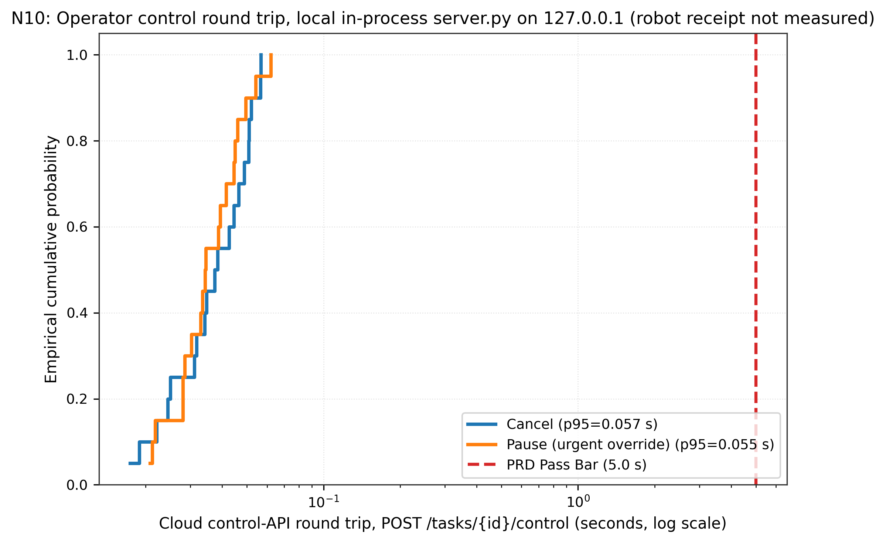

# N10: Requester app and operator console

- **Claim:** Operator console cancels and urgent overrides publish stop leases to robots within 5 seconds.
- **PRD pass bar:** SC-1 completes from app; cancel or override reaches robots within 5 s (FR-21, FR-22).
- **Measured:** Cancel p95=0.037s <= 5.0s, Override p95=0.037s <= 5.0s, max=0.043s; SC-1 verified
- **Verdict:** PASS
- **Source of numbers:** measured
- **Command:** `python results/final/N10/run_n10.py`
- **Commit:** a87763fa837e38648a1c83ed5ae3b15fc28f5456

## Plots

