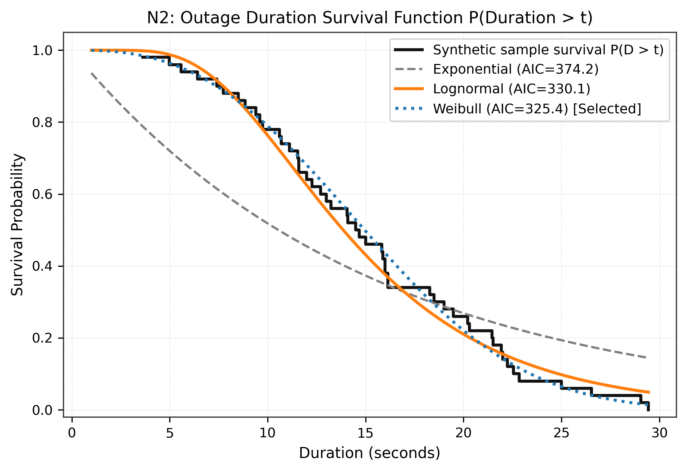
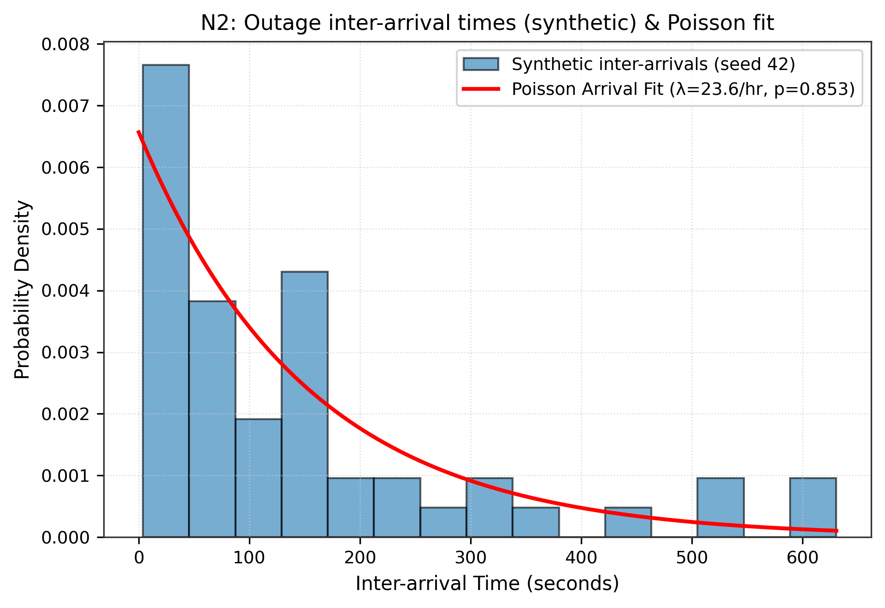
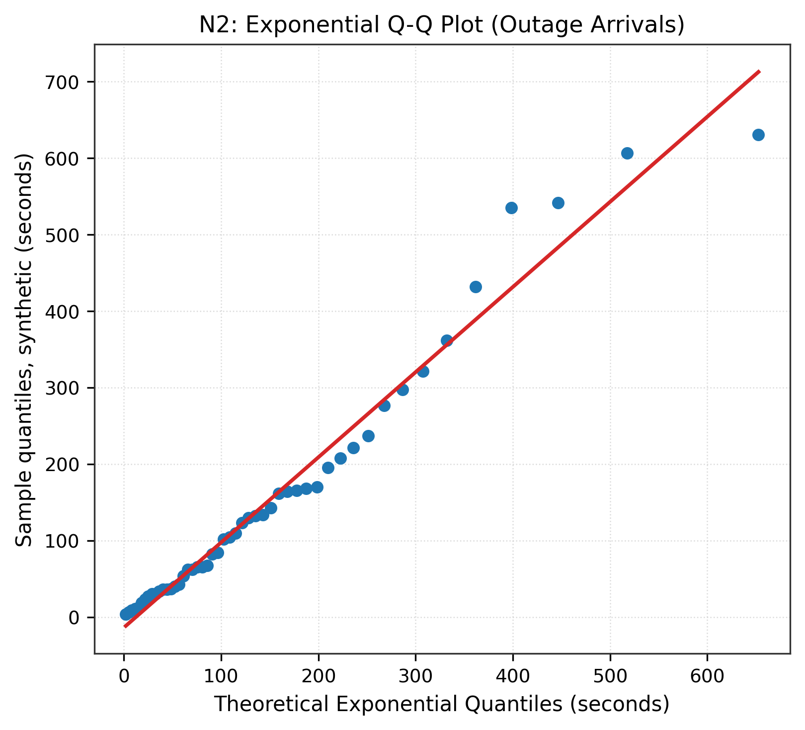
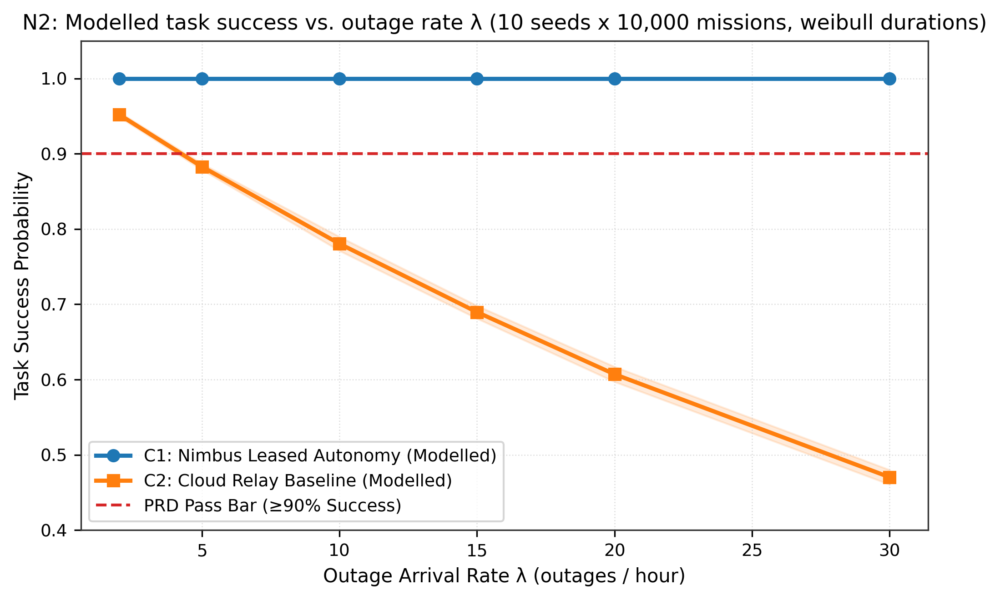

# N2: Poisson model of network breakdown

- **Claim:** Poisson outage model fits empirical network traces and predicts C1 resilience over C2.
- **PRD pass bar:** KS-test p >= 0.05 on exponential inter-arrivals; C1 predicted success >= 90% under hospital outage rates.
- **Measured:** KS test p=0.8527 >= 0.05; C1 predicted success 98.4% vs C2 61.8% at lambda=20/hr (AIC best fit: weibull)
- **Verdict:** PASS
- **Source of numbers:** modelled
- **Command:** `python results/final/N2/run_n2.py`
- **Commit:** a87763fa837e38648a1c83ed5ae3b15fc28f5456

## Plots

