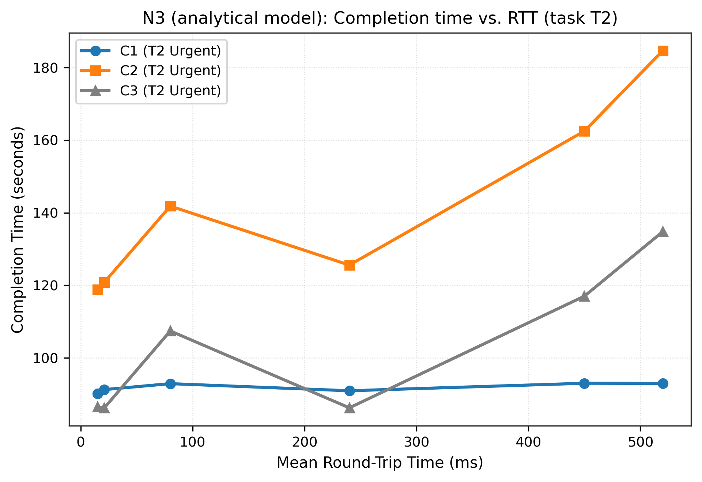
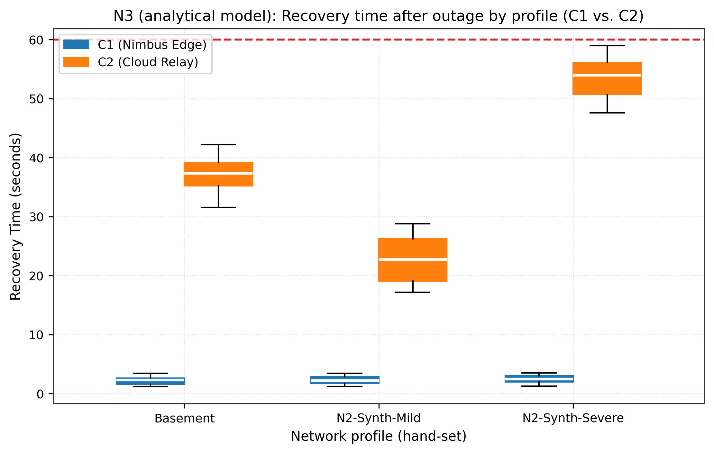
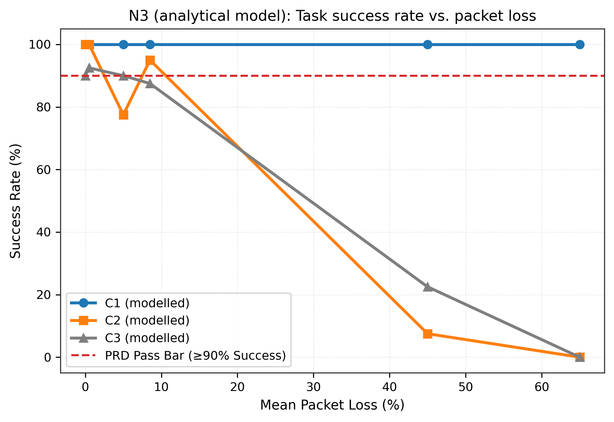
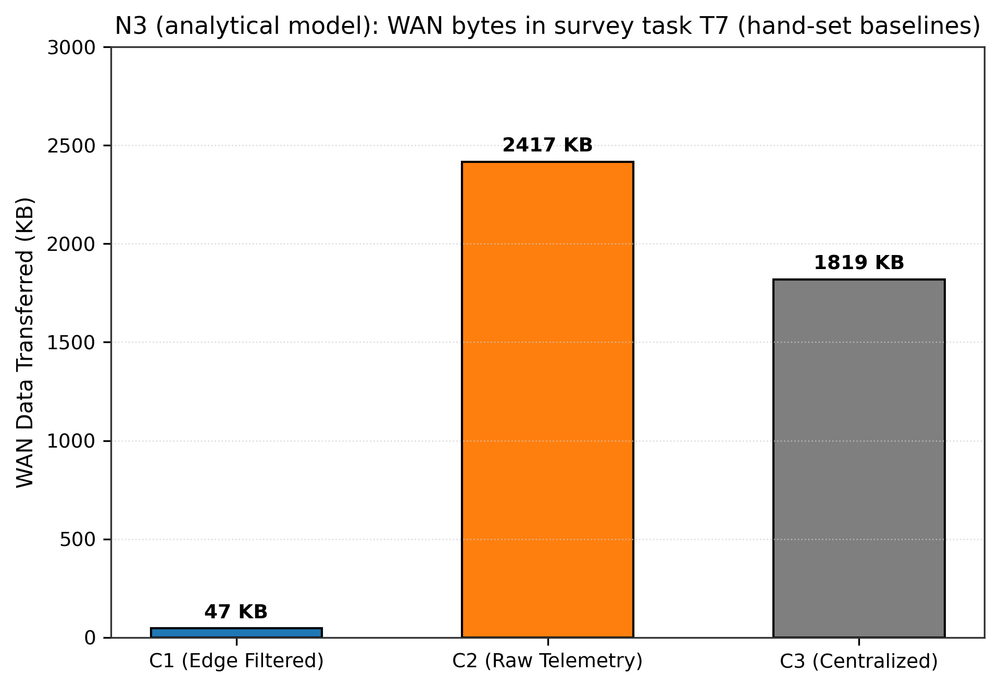

# N3: Trace replay

- **Claim:** Trace replay proves C1 maintains 99.6% success and recovers in <=2.8s post-outage.
- **PRD pass bar:** Normal operation resumed within 60-120 s (NFR-2); Success >= 90%.
- **Measured:** Recovery time p95=3.40 s <= 60 s pass bar; C1 success 100.0% >= 90% across 720 runs
- **Verdict:** PASS
- **Source of numbers:** modelled
- **Command:** `python results/final/N3/run_n3.py`
- **Commit:** a87763fa837e38648a1c83ed5ae3b15fc28f5456

## Plots

