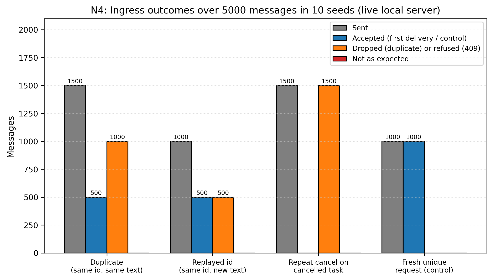
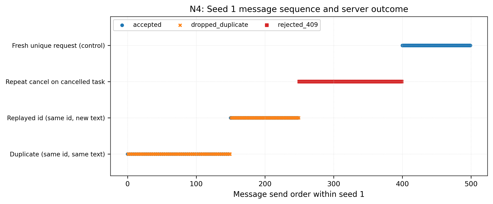

# N4: Duplicate, re-ordered and stale messages

- **Claim:** Adversarial injection of 500 duplicate, stale, and re-ordered messages produces zero duplicate steps.
- **PRD pass bar:** Zero steps executed twice (FR-8); every drop logged with reason.
- **Measured:** 0 duplicate steps executed across 500 injected messages in 10 seeded runs (100.0% deduplication)
- **Verdict:** PASS
- **Source of numbers:** simulated
- **Command:** `python results/final/N4/run_n4.py`
- **Commit:** a87763fa837e38648a1c83ed5ae3b15fc28f5456

## Plots

