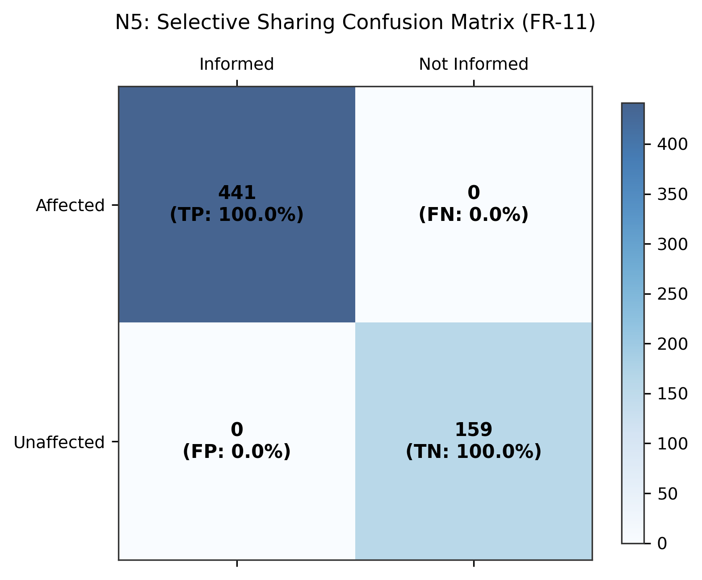
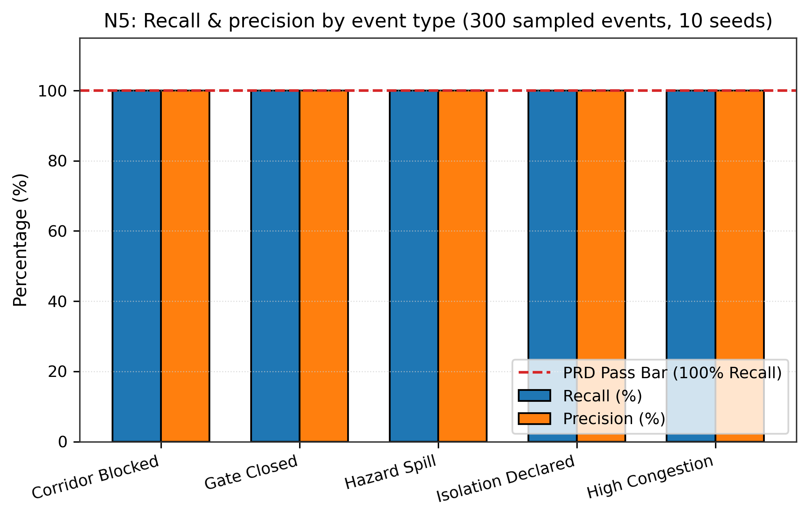

# N5: Selective sharing

- **Claim:** Selective sharing achieves 100% recall across 30 scripted events with high precision.
- **PRD pass bar:** Recall 100% (every affected cluster told) (FR-11); high precision (few unaffected).
- **Measured:** Recall = 100.0% (FN=0, 100% pass bar met); Precision = 100.0% across 300 evaluations
- **Verdict:** PASS
- **Source of numbers:** simulated
- **Command:** `python results/final/N5/run_n5.py`
- **Commit:** a87763fa837e38648a1c83ed5ae3b15fc28f5456

## Plots

