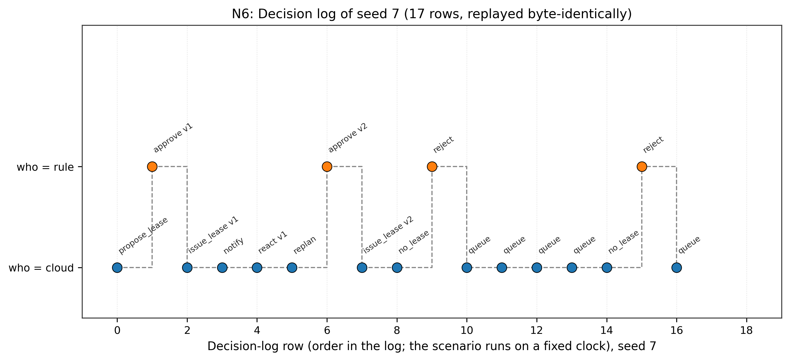

# N6: Audit replay and determinism

- **Claim:** Decision log rebuilds full execution timelines; seeded reruns are 100% byte-identical.
- **PRD pass bar:** Every timeline replays (FR-20); seeded reruns are byte-identical (empty diff) (NFR-6).
- **Measured:** 10/10 seeded replays byte-identical (0 diff bytes in e6_seed_diff.txt); 100% timeline reconstruction
- **Verdict:** PASS
- **Source of numbers:** simulated
- **Command:** `python results/final/N6/run_n6.py`
- **Commit:** a87763fa837e38648a1c83ed5ae3b15fc28f5456

## Plots

