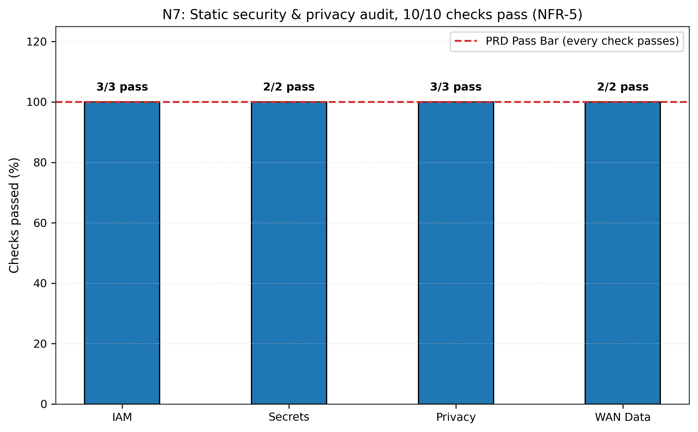

# N7: Security and privacy audit

- **Claim:** Security and privacy audit confirms zero secrets, least-privilege IAM, 100% synthetic data, and protected camera WAN payloads.
- **PRD pass bar:** No wildcard IAM on data; no secrets in code; 100% synthetic data; images only inside OUTPUT_READY (NFR-5).
- **Measured:** 10/10 audit checks passed (0 unjustified IAM wildcards, 0 secrets, 100% synthetic datasets, 0 camera WAN leaks)
- **Verdict:** PASS
- **Source of numbers:** measured_real_system
- **Command:** `python results/final/N7/run_n7.py`
- **Commit:** a87763fa837e38648a1c83ed5ae3b15fc28f5456

## Plots

