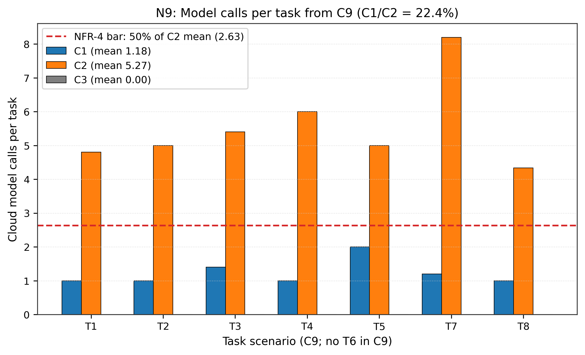
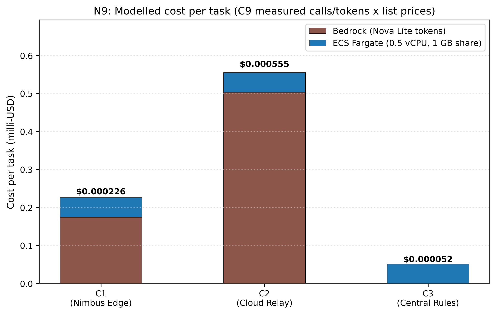

# N9: Cost per task

- **Claim:** C1 needs at most half the cloud model calls of C2 (NFR-4), and the cost per task can be reported for C1, C2 and C3 from measured counts.
- **PRD pass bar:** C1 model calls <= 50% of C2 (NFR-4); Cost per task reported for all configurations.
- **Measured:** from C9's 135 real-Bedrock tasks: calls per task C1 1.18, C2 5.27, C3 0.00; C1/C2 = 22.4% (bootstrap 95% CI 19.8% to 25.2%); modelled cost per task (Bedrock tokens + Fargate share) C1 $0.000226, C2 $0.000555, C3 $0.000052
- **Verdict:** PASS
- **Source of numbers:** modelled (offline: prices results/final/C9/raw/tasks.jsonl, 135 tasks, model none called here; C9 counts came from apac.amazon.nova-lite-v1:0)
- **Command:** `python results/final/N9/run_n9.py`
- **Commit:** 5ea3e6aab3569b621b727457687dff63687cf70f-dirty, run 2026-11-12T08:28:57Z to 2026-11-12T08:28:57Z

## Plots

## Notes

- Call and token counts are C9's measurements (results/final/C9/raw/tasks.jsonl, real Bedrock Nova Lite, commit 4c97ce3-dirty); this runner only prices them. The NFR-4 verdict is C9's measured ratio, recomputed here.
- Priced terms: Bedrock tokens ($0.06 / $0.24 per 1M in/out) and a Fargate share (0.5 vCPU x $0.04048/h + 1 GB x $0.004445/h, divided by 3600 s/h). The Fargate rates are AWS's us-east-1 list prices as used in docs/cost-accounting-audit.md; ap-south-1 is somewhat higher.
- Fargate share assumption: the service is always on, so its per-task cost depends on throughput. Each task is charged 7.52 s of container time, the C9 run's wall clock (1015 s) divided by its 135 tasks; the same for every configuration (C9 does not split time by configuration). At lower throughput the share is larger.
- Not priced: IoT, DynamoDB, SQS, S3, transfer, API Gateway and CloudWatch terms, because C9 did not log those counters per task.
- C9 has no T6 tasks; T5 tasks stayed 'leased' in C9 (the harness does not finish them), so they count calls but not completion.
- No AWS API (CloudWatch, Cost Explorer) is called and no billing data is stored; earlier versions of this runner did both and drew counts at random.
