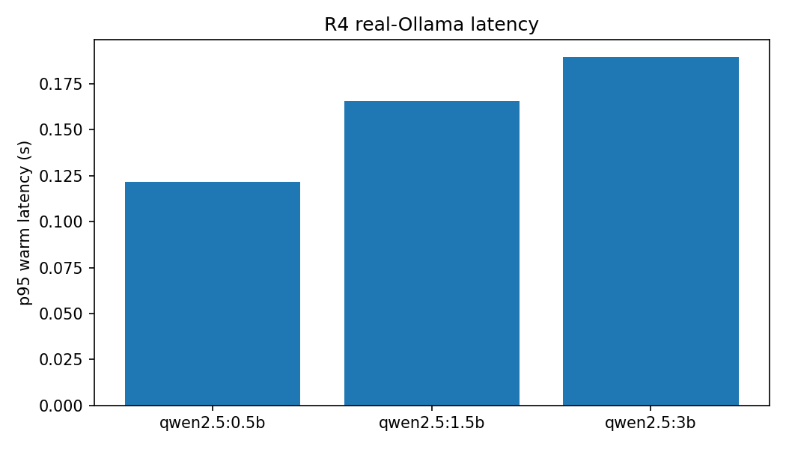
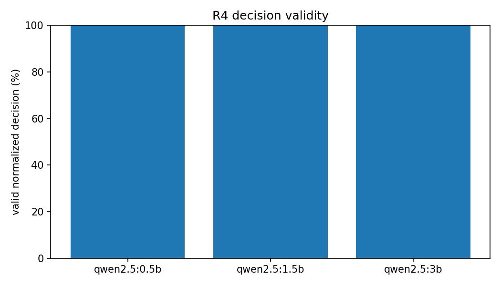

# R4: Edge SLM Benchmarking

- **Claim:** Benchmark candidate edge models on the pinned edge hardware (speed, valid outputs) (E1).
- **PRD pass bar:** Edge decisions complete within 10 s (p95) on the pinned edge hardware (NFR-1; FR-3).
- **Measured:** qwen2.5:0.5b: p95 warm 0.122 s, JSON 100.0%, allowed 100.0%, rule fallbacks 0; qwen2.5:1.5b: p95 warm 0.166 s, JSON 100.0%, allowed 100.0%, rule fallbacks 0; qwen2.5:3b: p95 warm 0.189 s, JSON 100.0%, allowed 100.0%, rule fallbacks 0
- **Verdict:** PASS
- **Source of numbers:** measured (Ollama, real local model)
- **Command:** `./scripts/R4.sh --full`
- **Commit:** run 2026-11-07T17:36:22.306297+00:00

- **Workload:** 5 existing E1 labelled situations × 10 repetitions × 3 models.
- **Backend:** actual local Ollama, sequential execution; no mock mode.
- **Generation policy:** existing `EdgeSLMEngine` fixed settings: `num_predict=150`, `temperature=0.2`.
- **Scope limitation:** E1 currently has five labelled situations, not forty.
- **Metric limitation:** the engine returns a validated decision or rule fallback, so `valid_json` measures the returned normalized decision; raw malformed-model-output rate is not exposed. Output tokens use E1's serialized-decision estimate, not Ollama generation telemetry.

## Summary

| Model | p50 warm s | p95 warm s | Cold s | JSON % | Allowed % | Tokens/s (estimated) | Peak GPU MB | Rule fallbacks | PASS |
| --- | ---: | ---: | ---: | ---: | ---: | ---: | ---: | ---: | --- |
| qwen2.5:0.5b | 0.099639 | 0.121664 | 0.028782367706298828 | 100.0 | 100.0 | 396.977 | 7387 | 0 | true |
| qwen2.5:1.5b | 0.132462 | 0.165560 | 0.023885011672973633 | 100.0 | 100.0 | 282.527 | 7387 | 0 | true |
| qwen2.5:3b | 0.182554 | 0.189462 | 0.02476644515991211 | 100.0 | 100.0 | 168.026 | 7387 | 0 | true |

## Plots

